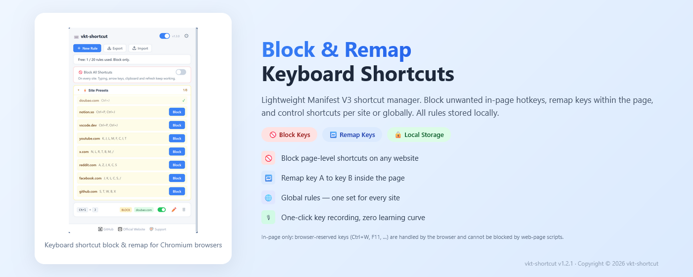

# vkt-shortcut — Keyboard Shortcut Manager

English | [中文](languages/README_zh.md) | [Español](languages/README_es.md) | [Deutsch](languages/README_de.md) | [日本語](languages/README_ja.md) | [Français](languages/README_fr.md)

A lightweight browser extension that blocks and remaps keyboard shortcuts. Stop unwanted hotkeys, redirect keys to custom actions, and take full control of your keyboard.

> Chromium-based · Manifest V3 · No tracking · Fully Local Processing

---

## Why vkt-shortcut?

Most shortcut blockers only block keys — they can't remap them. vkt-shortcut does both: **blocking is free and unlimited**, while key remapping and cross-device sync are the paid extras.

| Advantage | Detail |
|-----------|--------|
| 🚫 **Block Keys** | Intercept and disable page-level shortcuts on any website (web apps, games) |
| 🔁 **Remap Keys** | Redirect one key combo to another inside the page (Premium) |
| 🌐 **Global + Per-Site Rules** | Rules apply on every website by default; optionally scope a rule to one site (subdomains included) |
| ⚡ **Site Presets** | One-click block rules for well-known shortcut conflicts on popular sites — YouTube (K/J/L/M/F/C/I/T), X (N/L/R/T/B/M, /), Reddit (A/Z votes, J/K/C/S), Facebook (J/K/L/C/S, /), GitHub (S/T/W/B/X), Doubao's Ctrl+J, Notion's Ctrl+P/J, VS Code Web's Ctrl+P/J. Every supported site is listed in the panel, so you don't have to visit it first. Each preset key becomes one editable rule |
| 🔇 **Block All Shortcuts** | A per-site toggle that neutralizes every page shortcut, plus a global switch on the panel for all sites at once (typing, arrow-key navigation, clipboard and refresh still work; per-site pause takes priority) |
| ⌨️ **Key Recording** | Press the key combo directly — captured automatically |
| 🔄 **Cross-device Sync** | Mirror rules through the browser account you are already signed in to — `chrome.storage.sync` on Chrome, Edge sync on Edge. No server of ours is involved (Premium) |
| 📤 **Import / Export** | Backup and restore rules as JSON (free) |

---

## Free vs Premium

| | Free | Premium (license) |
|---|---|---|
| Rule count | **Unlimited** | Unlimited |
| Block shortcuts | ✅ | ✅ |
| Site presets, per-site and global block-all, per-site pause | ✅ | ✅ |
| Import / export JSON | ✅ | ✅ |
| **Key remapping** | ❌ | ✅ |
| **Cross-device sync** (browser account) | ❌ | ✅ |
| Account / sign-up | Not required | License key only |
| Network | None | License validation only |

Free is a complete blocker, not a trial: there is **no rule cap since v1.5.0** and no upsell on any blocking feature. Premium adds the two things that need server-verified entitlement — remapping, and syncing rules between devices.

### How sync works

Sync uses the browser's own account storage (`chrome.storage.sync`), not a server of ours:

- Chrome syncs through your **Google** account, Edge through your **Microsoft** account. The two never sync with each other.
- Rules stay authoritative in `chrome.storage.local`; the cloud copy is only a transport.
- Each rule is stored as its own item (one item per rule) because the sync API caps a single item at 8 KB. The real ceiling is the 100 KB total payload, i.e. roughly **200 rules**; the panel reports byte usage.
- Deletions travel as tombstones and merges take the newest `updatedAt`, so two devices cannot silently resurrect or overwrite each other.
- The per-site pause and block-all switches travel with the rules; your licence key and install id never leave the device.
- If the browser is not signed in, `chrome.storage.sync` still works but stays local — the panel says so.

---

## Preview

  

---

## Supported Browsers

| Browser | Status |
|---------|--------|
| Google Chrome | ✅ Fully supported |
| Microsoft Edge | ✅ Fully supported |
| Other Chromium-based browsers | ✅ Should work |

---

## Installation

| Store | Link |
|---|---|
| Chrome Web Store | [Install for Chrome](https://chromewebstore.google.com/detail/afpgmhahakgmmjomkkocecnbcdjndial) |
| Microsoft Edge Add-ons | [Install for Edge](https://microsoftedge.microsoft.com/addons/detail/odbcgmpmlcobfpahpcpcikhbfhajmila) |

> Install only from the official stores above — avoid third-party download sites.

---

## Usage

1. **Click the ⌨️ icon** in your browser toolbar to open the side panel
2. **Click "➕ New Rule"** to create a shortcut rule
3. **Choose rule type** — Block (disable key) or Remap (redirect key A → key B)
4. **Set the source key** — click the input field and press the key combo you want to intercept
5. **For remap: set the target key** — click the target input and press the combo to redirect to
6. **(Optional) Scope to a website** — enter a domain like `youtube.com` (subdomains included), or leave blank to apply everywhere
7. **Save the rule** — it takes effect immediately, no page refresh needed
8. **Toggle rules** — use the global switch to pause without deleting
9. **(Shortcut) Panel bars** — a collapsible **Site Presets** list shows every supported site up front with its known conflicts and a one-click **Block** (✓ once all its keys are covered); the bar above it blocks all page shortcuts on every site at once, and the current-site bar adds a per-site block-all toggle plus a site pause switch

---

## Use Cases

- **Web apps** — Block F1 from opening help in Google Docs, Office 365, or any web editor
- **Online games** — Disable page-defined shortcuts that interfere with gameplay (note: browser-reserved keys like Ctrl+W or F11 never reach the page, so page-level interception cannot block them; extensions using `chrome.commands` can only neutralize a few by binding them to empty commands)
- **Developer tools** — Remap DevTools shortcuts to avoid conflicts with IDE keybindings
- **Accessibility** — Remap complex combos to simpler keys for easier access
- **Presentation mode** — Block all page-level shortcuts except navigation during presentations

---

## Privacy

- ✅ Rules never leave your browser — blocking/remapping happens entirely locally
- ✅ No analytics, no tracking, no cookies
- ✅ Rules stored in `chrome.storage.local` only
- ✅ Only `storage` + `sidePanel` permissions, plus `api.annmax1983.com` for optional license validation
- ✅ No telemetry, no third-party scripts, no ads
- ✅ Free users generate **zero** network traffic; sync uses your browser account, never our server
- ✅ Import/export works on local JSON files that you control

---

## Copyright Disclaimer

This extension intercepts keyboard events on web pages at the browser level for the user's convenience. All content, functionality and intellectual property of the original websites remain unchanged. Blocking or remapping shortcuts does not modify any website content — it only prevents or redirects keyboard input before it reaches the page.

---

## Source Code Notice

> ⚠️ **This repository does not publish source code.** It contains only usage documentation, release notes, and support resources. The extension is distributed exclusively through the Chrome Web Store. No offline installation packages or end-user source code are provided.

---

## License

Copyright © 2026 vkt-shortcut. All rights reserved.

---

## ❤️ Support

If you find vkt-shortcut helpful, consider buying me a coffee!

**[👉 Click here to support](https://ko-fi.com/annmax?ref=vkt-shortcut)**
